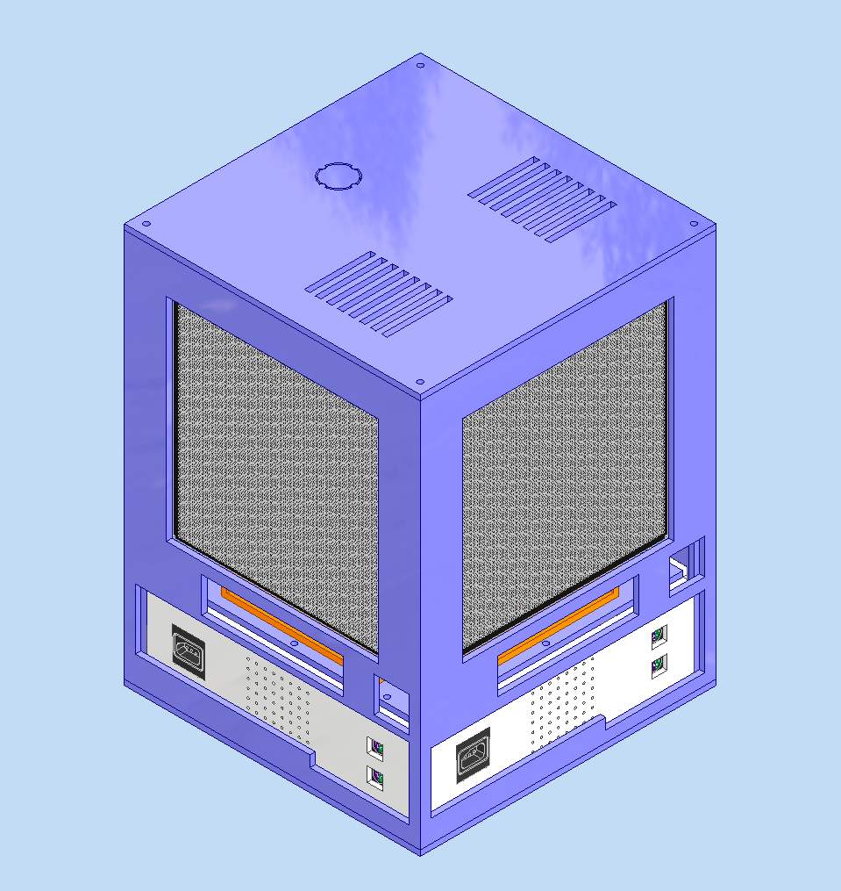
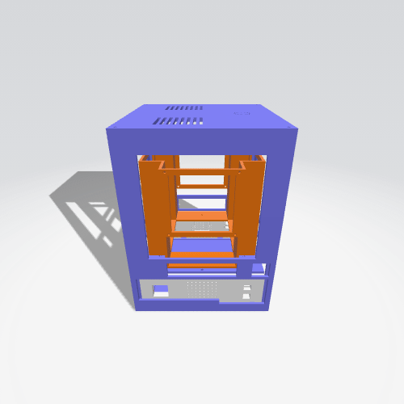
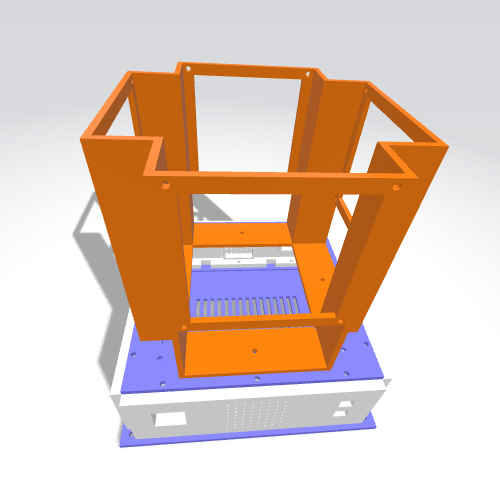
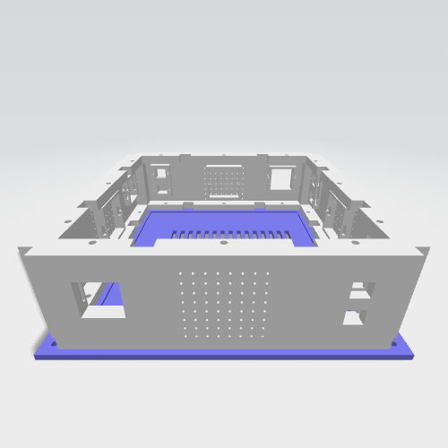
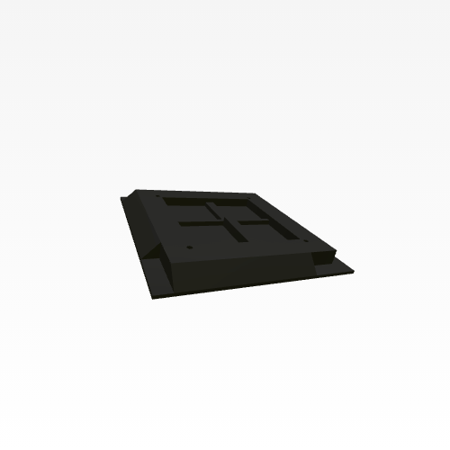
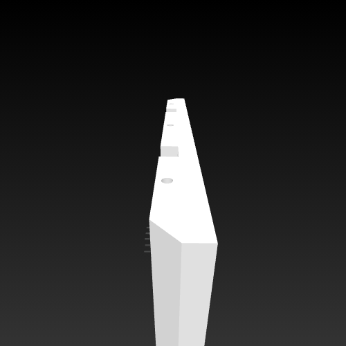

#  MODEL_3D (Propuesta Abierta)



**Estado:** 🟡 En Revisión por el Equipo | **Fase:** 1 (Modelado Conceptual)

Este documento presenta una propuesta arquitectónica y de diseño inicial para la nueva consola de videojuegos. El objetivo de este repositorio es proporcionar el primer modelo 3D conceptual (carcasa externa y distribución espacial) para que todos los miembros del grupo puedan inspeccionarlo, proponer modificaciones y llegar a un acuerdo técnico antes de pasar a la fase de prototipado físico e integración electrónica.

---

## Resumen del Modelo 3D Base

El primer activo subido a este repositorio es la carcasa conceptual. Se trata de un **prisma rectangular** diseñado para ofrecer una experiencia multijugador simultánea y omnidireccional, albergando hardware de visualización independiente en cada una de sus cuatro caras laterales.

### Especificaciones del Chasis y Conectividad
*   **Factor de Forma:** Prisma rectangular en formato torre.
*   **Puertos de Entrada (I/O):** Integración de conectores *legacy* físicos ubicados en la base o paneles inferiores.
    *   Puertos para raton o teclado (PS2).
    *   Puertos para mandos de Nintendo Entertainment System (NES).




Se observa la estructura externa perimetral, que incluye el panel superior con ranuras de ventilación y los amplios marcos en las cuatro caras diseñados para alojar las pantallas. En el interior se aprecia cómo se integra el esqueleto de soporte central con el armazón externo y la base inferior, mostrando el perfil completo del dispositivo armado.




El esqueleto o estructura interna de montaje. Es una pieza central con diseño de pilares y travesaños que se encarga de sujetar y alinear los componentes electrónicos, proporcionando la rigidez principal a todo el ensamblaje. Se muestra montada directamente sobre el módulo base para ilustrar su posición estructural dentro del sistema




Esta pieza cuenta con aberturas rectangulares en sus caras laterales estructuradas específicamente para alojar los puertos de los controladores. Además, incorpora un área con un patrón de múltiples perforaciones y una rejilla en la plataforma inferior para asegurar el flujo de aire y la disipación térmica del hardware.
---


<model-viewer src="Propuesta_Modelo_3D/Modelo_Carcasa_Completo.glb" camera-controls auto-rotate></model-viewer>


## 🖥️ Arquitectura de Pantallas (Configuración por Cara)

El diseño estipula que **cada una de las 4 caras** del prisma contiene un módulo de visualización dual, separando el área de juego de la telemetría (HUD).

| Módulo | Tipo de Pantalla | Dimensiones Físicas | Resolución / Matriz | Función Principal |
| :--- | :--- | :--- | :--- | :--- |
| **Display Principal** | Panel de Juego | 192 mm | 64 x 64 | Renderizado del entorno de juego y acción principal. |
| **Display Secundario** | Matriz LED | 128 mm (Ancho) x 32 mm (Alto) | 8 x 32 | Indicadores de vida, salud e información complementaria (HUD). |



---

## ⚙️ Esquema de Hardware (Draft Técnico)

```yaml
dispositivo:
  nombre_proyecto: "Video_Consola"
  tipo: "Video Consola Multipantalla"
  carcasa:
    geometria: "Prisma Rectangular"
    caras_activas: 4
  interfaces_perifericos:
    - tipo: "(PS2)"
      estado: "Requerido"
    - tipo: "NES Controller"
      estado: "Requerido"
  display_por_cara:
    principal_gameplay:
      tipo :  "HUB75"
      tecnologia: "Matriz RGB"
      tamano_mm: 192 x 192
      matriz: "64x64"
    secundario_telemetria:
      tipo : "MAX7219"
      tecnologia: "Módulo Matriz LED"
      dimensiones_mm: [128, 32]
      matriz: "8x32"
      datos_asignados: ["Vida", "Salud", "Info Complementaria"]
```



---

## 🤝 Proceso de Revisión y Consenso

Para avanzar a la siguiente etapa de diseño (ubicación de componentes internos y modelado de ensamblaje).

**Acciones requeridas por el equipo:**
1.  **Visualizar el Modelo:** Navegar a la carpeta `/models/` y hacer clic en el archivo `.stl` para utilizar el visor 3D integrado en GitHub (rotación en 360°).
2.  **Validar Proporciones:** Verificar visualmente si la distribución de las dos pantallas por cara (192mm y 128x32mm) es ergonómica y estéticamente funcional.
3.  **Feedback:** Abran un *Issue* en este repositorio con sugerencias de modificación (ej. ubicación de los puertos PS2/NES, ventilación) o dejen su aprobación en los comentarios de este documento para unificar criterios.

